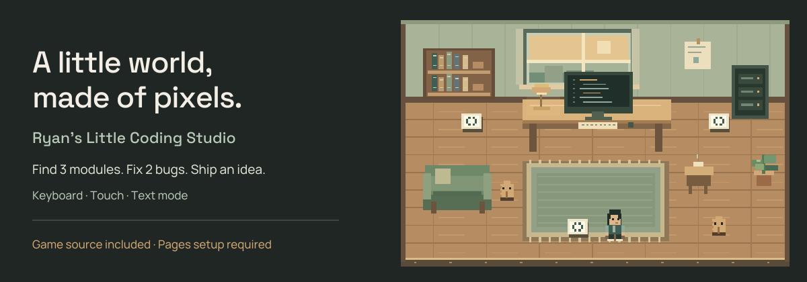
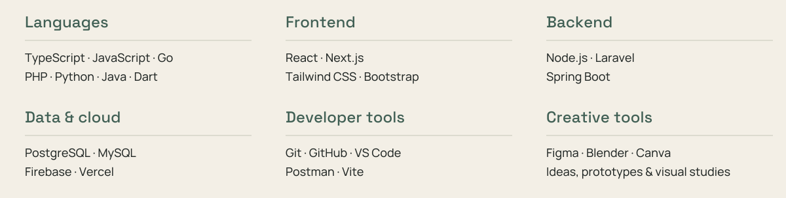
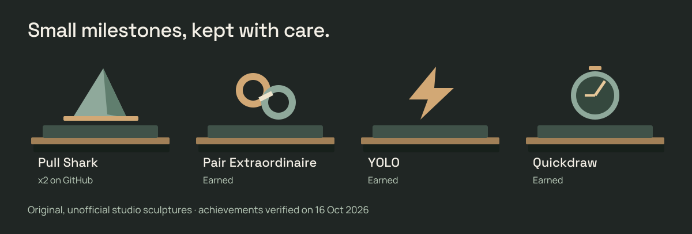
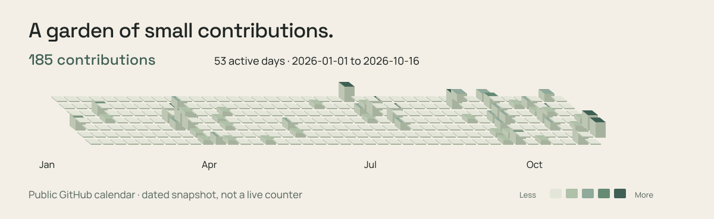

<picture>
  <source media="(max-width: 600px)" srcset="assets/hero-mobile.svg">
  
</picture>

  <a href="#selected-engineering-work">Selected work</a> &nbsp;·&nbsp;
  <a href="#explore-my-little-world">A little world</a> &nbsp;·&nbsp;
  <a href="#achievements--engineering-activity">Engineering activity</a> &nbsp;·&nbsp;
  <a href="https://linkedin.com/in/naufalazryan">Say hello ↗</a>

## A little about me

I'm **Naufal Faiq Azryan** — Ryan for short. I'm a software engineer and Informatics student at **Telkom University**, based in Indonesia.

I enjoy turning practical problems into useful applications, from the backend decisions that keep things dependable to the small interface details that make them pleasant to use. Lately, I've been exploring environmental intelligence, backend architecture, and what AI can bring to everyday software.

## Selected engineering work

Four different problems. A shared curiosity about how things work.

<a href="https://github.com/ryanazryan/auvrion-biosphere">
  <picture>
    <source media="(max-width: 600px)" srcset="assets/project-auvrion-mobile.svg">
    
  </picture>
</a>

[**Auvrion Biosphere**](https://github.com/ryanazryan/auvrion-biosphere) · **Foundations in progress.** Exploring biodiversity observations, fire-risk monitoring, AIoT and WebGIS. Authentication and database foundations exist; the environmental product capabilities are still being developed.

<a href="https://github.com/ryanazryan/ruma">
  <picture>
    <source media="(max-width: 600px)" srcset="assets/project-ruma-mobile.svg">
    
  </picture>
</a>

[**Ruma Marketplace**](https://github.com/ryanazryan/ruma) · **Architecture & workspace setup.** Commerce groundwork with a planned Next.js and NestJS architecture. The current repository contains the workspace skeleton; catalog, checkout and service integrations remain plans.

<a href="https://github.com/ryanazryan/Hydropedia">
  <picture>
    <source media="(max-width: 600px)" srcset="assets/project-hydropedia-mobile.svg">
    
  </picture>
</a>

[**Hydropedia**](https://github.com/ryanazryan/Hydropedia) · **Academic team project.** Hydroponic plant management with pH and nutrient monitoring views. Built with Java, Spring Boot, Thymeleaf and SQLite.

<a href="https://github.com/ryanazryan/sena">
  <picture>
    <source media="(max-width: 600px)" srcset="assets/project-sena-mobile.svg">
    
  </picture>
</a>

[**SENA Education**](https://github.com/ryanazryan/sena) · **Learning-platform project.** Literacy learning with student and teacher views, submission flows and feedback integration code. Built with React, TypeScript, Vite and Firebase; live service operation has not been verified here.

Original concept illustrations, not app screenshots. Project descriptions reflect source inspected on 16 October 2026. [Source notes](VERIFICATION.md).

## Explore my little world

<<<<<<< HEAD
=======
## Little Coding Studio

  
  &nbsp;
  

>>>>>>> 388d2f3 (Enhance README with game and source code links)
<a href="docs/">
  <picture>
    <source media="(max-width: 600px)" srcset="assets/game-preview-mobile.svg">
    
  </picture>
</a>

A tiny, playable studio for a quiet break. Find **3 modules**, fix **2 bugs**, and bring a small idea to life. Keyboard, touch controls, reduced motion, and a complete text mode are included.

**[Browse the game source](docs/)** · [Run locally or set up GitHub Pages](INSTALL.md#game)

The preview links to source. A live play link will be added after GitHub Pages is enabled and checked.

## Engineering toolkit

Tools I've worked with or explored — chosen for the problem, with plenty still to learn.

<picture>
  <source media="(max-width: 600px)" srcset="assets/toolkit-mobile.svg">
  
</picture>

## Achievements & Engineering Activity

<a href="https://github.com/ryanazryan?tab=achievements">
  <picture>
    <source media="(max-width: 600px)" srcset="assets/achievements-mobile.svg">
    
  </picture>
</a>

**Pull Shark ×2** · **Pair Extraordinaire** · **YOLO** · **Quickdraw**

Verified on 16 October 2026. These little sculptures are unofficial artwork; [view the original GitHub badges](https://github.com/ryanazryan?tab=achievements).

<!-- activity:start -->

**185 contributions · 53 active days** in the public calendar from 1 January to 16 October 2026. [Current activity on GitHub ↗](https://github.com/ryanazryan)

Local artwork with a [verifiable data snapshot](design/contributions.json). No live counter, streak promise, or external image service.
<!-- activity:end -->

## Elsewhere on the internet

[LinkedIn](https://linkedin.com/in/naufalazryan) &nbsp;·&nbsp; [Instagram](https://instagram.com/naufalazryan) &nbsp;·&nbsp; [Discord](https://discord.gg/naufalazryan) &nbsp;·&nbsp; [YouTube](https://www.youtube.com/@naufalazryan)

From my video notebook: [Konsep Dasar Basis Data](https://www.youtube.com/watch?v=2Y-i05hqKXg) · [Video HEI Telkom University](https://www.youtube.com/watch?v=GnV00HJbsH8)

---

**Thanks for stopping by the studio.** 
One useful thing, one thoughtful detail, one small step at a time. 
— Ryan
