<!--
  Ryan's Creative Engineering Studio — Pixel Edition
  Pixel-art animations are non-interactive in the GitHub README.
  Click the project cards to open their repositories, and deploy docs/ to GitHub Pages to play the game.
  The README is designed to work without JavaScript or external CSS.
-->

<div align="center">

<a href="https://github.com/ryanazryan">
  <picture>
    <source media="(max-width: 600px)" srcset="assets/hero-pixel-mobile.gif">
    
  </picture>
</a>

<p><strong><code>[ SOFTWARE ENGINEER ]</code></strong> &nbsp; <strong><code>[ FULL-STACK DEVELOPER ]</code></strong> &nbsp; <strong><code>[ INFORMATICS STUDENT ]</code></strong></p>

<p><em>Build. Explore. Repeat.</em></p>

<a href="#selected-work">Projects</a> &nbsp;·&nbsp;
<a href="#little-coding-studio">Mini Game</a> &nbsp;·&nbsp;
<a href="#inventory--tech-stack">Inventory</a> &nbsp;·&nbsp;
<a href="#youtube--video-notebook">Videos</a> &nbsp;·&nbsp;
<a href="#connect--social-portals">Connect</a>

</div>

---

## Player Profile

**Hi, I'm Naufal Faiq Azryan — Ryan for short.** I'm an Informatics student at **Telkom University**, a software engineer and full-stack developer based in Indonesia, with an interest in AI and useful digital products.

I enjoy backend architecture, thoughtful interfaces, and turning real-world problems into software. I'm exploring **environmental intelligence**, **web platforms**, and **AI-assisted development**, one project at a time.

```text
╔═══════════ QUEST LOG ═══════════╗
║ [✓] Keep learning              ║
║ [✓] Build useful projects      ║
║ [>] Share experiments          ║
║ [ ] The next great idea        ║
╚═════════════════════════════════╝
```

## Selected Work

*Four projects, four little worlds. Click any animated pixel-art scene to explore the repository.*

<a href="https://github.com/ryanazryan/auvrion-biosphere">
  <picture>
    <source media="(max-width: 600px)" srcset="assets/project-auvrion-pixel-mobile.gif">
    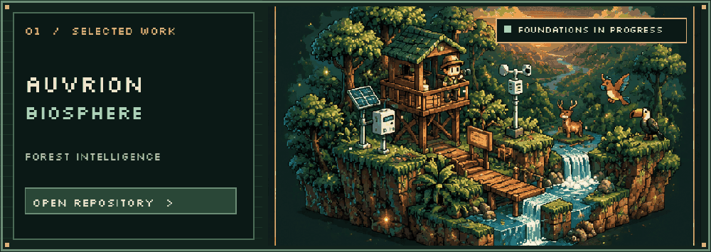
  </picture>
</a>

**[Auvrion Biosphere](https://github.com/ryanazryan/auvrion-biosphere)** · `Foundations in progress`  
Biodiversity observations, forest-fire risk monitoring, AIoT and WebGIS. Exploring a Next.js/TypeScript application with PostgreSQL/PostGIS foundations. Environmental product capabilities are still under development.

<a href="https://github.com/ryanazryan/ruma">
  <picture>
    <source media="(max-width: 600px)" srcset="assets/project-ruma-pixel-mobile.gif">
    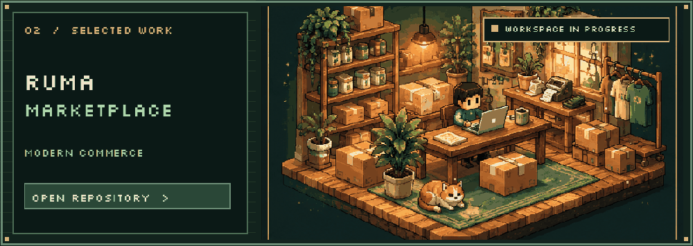
  </picture>
</a>

**[Ruma Marketplace](https://github.com/ryanazryan/ruma)** · `Architecture & workspace setup`  
Modern commerce groundwork, with a planned Next.js and NestJS architecture. The inspected project state was an early workspace skeleton, not a completed marketplace.

<a href="https://github.com/ryanazryan/Hydropedia">
  <picture>
    <source media="(max-width: 600px)" srcset="assets/project-hydropedia-pixel-mobile.gif">
    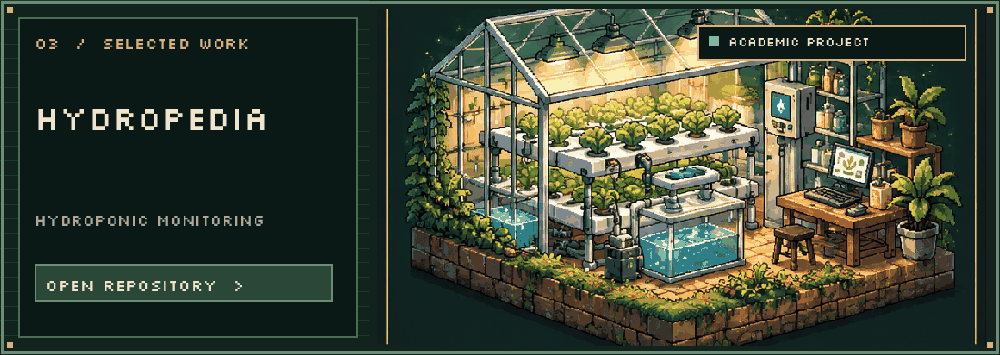
  </picture>
</a>

**[Hydropedia](https://github.com/ryanazryan/Hydropedia)** · `Academic team project`  
Hydroponic plant management and environmental monitoring views, built around Java, Spring and SQLite concepts.

<a href="https://github.com/ryanazryan/sena">
  <picture>
    <source media="(max-width: 600px)" srcset="assets/project-sena-pixel-mobile.gif">
    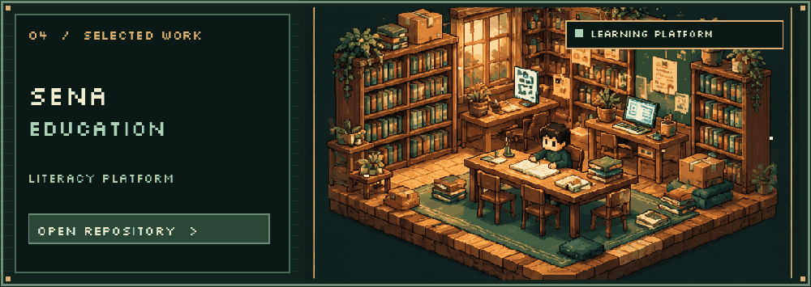
  </picture>
</a>

**[SENA Education](https://github.com/ryanazryan/sena)** · `Learning-platform project`  
Literacy learning with student and teacher views, score submissions, and feedback integration. Built with React, TypeScript, Vite and Firebase.

<sub>Illustrative pixel-art concepts, not product screenshots. Descriptions preserve the original repository review baseline from 16 October 2026; see [verification notes](VERIFICATION.md).</sub>

## Little Coding Studio

<a href="docs/">
  <picture>
    <source media="(max-width: 600px)" srcset="assets/game-preview-pixel-mobile.gif">
    
  </picture>
</a>

An 8-bit mini adventure: collect **3 code modules**, fix **2 bugs**, then ship a tiny **garden journal**. The actual game includes keyboard/touch controls and an accessible text mode.

**[Browse game source](docs/)** · **[Deploy / play instructions](INSTALL.md#game)**

<sub>GitHub does not run Canvas or JavaScript inside README. The animated GIF plays here; enable GitHub Pages from the `main` branch `/docs` directory and replace the source link with your verified game URL.</sub>

## Inventory / Tech Stack

*Skills and tools I've used or explored — not a claim of mastery of every item.*

<p align="center">
  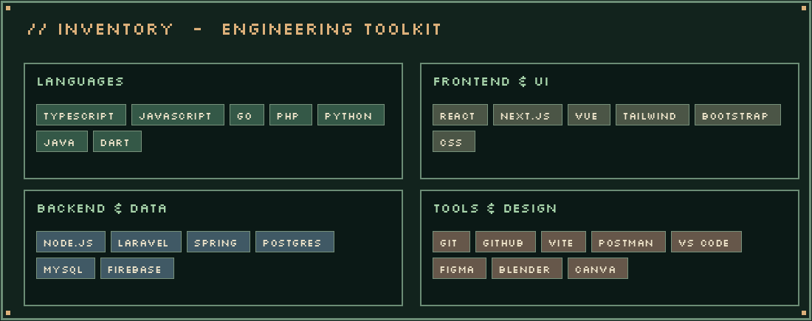
</p>

<details>
<summary><b>Open detailed skill inventory</b></summary>

**Languages:** TypeScript, JavaScript, PHP, Python, Java, Dart, Go, R  
**Frontend / UI:** React, Vue, Next.js, Tailwind CSS, Bootstrap, jQuery, DaisyUI, React Query, React Router, React Hook Form  
**Backend:** Node.js, Laravel, CodeIgniter, Spring, explored NestJS  
**Data / Cloud:** PostgreSQL, MySQL, Firebase, Vercel, Netlify, Nginx, Apache  
**Tools:** Git, GitHub, GitLab, npm, Vite, Postman, VS Code, Android Studio  
**Creative / Learning:** Figma, Blender, Canva, freeCodeCamp, W3Schools

</details>

<p align="center">
  
</p>

</details>

## YouTube / Video Notebook

*The video previews are custom pixel-art cover illustrations; click to open the real videos on YouTube.*

<table>
  <tr>
    <td width="50%" align="center">
      <a href="https://www.youtube.com/watch?v=2Y-i05hqKXg">
        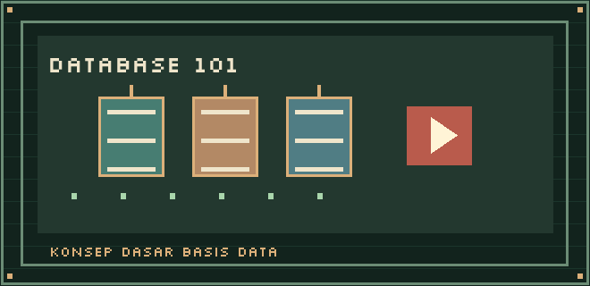
      </a><br>
      <b>Konsep Dasar Basis Data</b>
    </td>
    <td width="50%" align="center">
      <a href="https://www.youtube.com/watch?v=GnV00HJbsH8">
        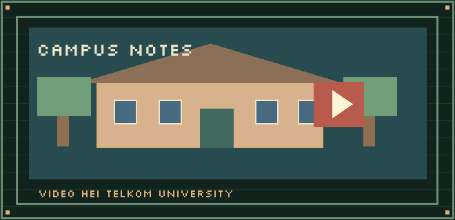
      </a><br>
      <b>Video HEI Telkom University</b>
    </td>
  </tr>
</table>

<p align="center">
  <a href="https://www.youtube.com/@naufalazryan">
    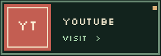
  </a>
</p>

<details>
<summary><b>See the original YouTube video thumbnails</b></summary>

<a href="https://www.youtube.com/watch?v=2Y-i05hqKXg"></a>
<a href="https://www.youtube.com/watch?v=GnV00HJbsH8"></a>

</details>

## Connect / Social Portals

<p align="center">
  <a href="https://github.com/ryanazryan">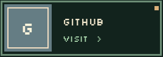</a>
  <a href="https://linkedin.com/in/naufalazryan">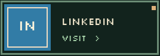</a>
  <a href="https://instagram.com/naufalazryan">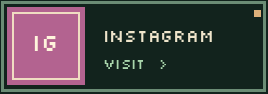</a>
  <a href="https://discord.gg/naufalazryan">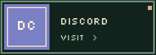</a>
  <a href="https://www.youtube.com/@naufalazryan"></a>
</p>

<sub>Social handles are retained from the previous README. Check that your Discord invite is still valid.</sub>

---

<p align="center">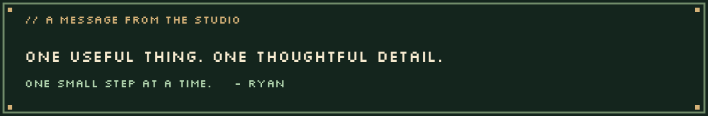</p>

<details>
<summary><b>Profile views (external counter)</b></summary>

<p align="center"></p>

</details>

<div align="center">

<p><code>&lt; THANKS FOR VISITING RYAN'S STUDIO /&gt;</code></p>

<p><strong>One useful thing. One thoughtful detail. One small step at a time.</strong></p>

<sub>Made with care · Pixel-art concepts + original code · © Ryan</sub>

</div>
